# Kubernetes Cluster Chronicles

Migrate a containerized diagnostic app to a local **Minikube** cluster: Deployments, Services, Ingress, PV/PVC, in-cluster Jenkins CI/CD, Prometheus/Grafana, EFK logging, and Alertmanager.

## Topology

| Namespace   | Role |
| ----------- | ---- |
| `app`       | Backend (1 replica) + Frontend (2 replicas) + Ingress + HPA |
| `monitoring`| kube-prometheus-stack (Prometheus Operator, Grafana, Alertmanager) |
| `logging`   | Elasticsearch (2), Fluent Bit, Kibana |
| `cicd`      | Jenkins + local registry |

```text
Browser → Ingress (chronicles.local and catch-all) → frontend:80 (×2) → backend:3000 (×1)
Jenkins → Kaniko/Trivy → registry → kubectl rollout
Fluent Bit → Elasticsearch → Kibana
Prometheus ← backend ServiceMonitor, ingress-nginx :10254, blackbox probes, node / kube metrics
```

## Prerequisites

- Docker Desktop (or Docker Engine)
- Enough RAM for Minikube (default **4 vCPU / 10 GB / 40 GB disk** in [`config/cluster.yml`](config/cluster.yml); hard cap 8 / 18 GB). Raise on a larger host if Docker exposes more CPUs.
- `make chronicles` installs **minikube**, **kubectl**, and **helm** when missing

## Quick start

```bash
make chronicles          # Minikube + images + manifests + monitoring + Jenkins
make status
make app-verify
make dashboard           # http://127.10.10.10:3030  (admin / devops)
```

## Access

Use these assigned addresses.

| Surface | Address |
|---------|---------|
| Dashboard | http://127.10.10.10:3030 |
| App through Ingress | http://chronicles.local/ — address is the Minikube IP (`kubectl get ingress -n app`) |
| Frontend Service | `frontend.app.svc.cluster.local:80` (two ready endpoints) |
| Backend Service | `backend.app.svc.cluster.local:3000` (one replica; not an Ingress rule) |

Both Ingress rules send HTTP to the **frontend** Service. The field named Backend on an Ingress is that Service, not the API Deployment. The frontend proxies `/api/` to the backend inside the cluster.

Grafana, Prometheus, Kibana, and Jenkins stay on their ClusterIP Services. Open them from the dashboard Observe page. Grafana and Jenkins login: `admin` / `devops`.

## Application

```text
app/
├── backend/     Express — /health, /metrics, /metrics/live, /metrics/prom
├── frontend/    React + Vite — nginx proxies /api → backend Service
└── docker-compose.yml   # local single-host reference
```

Custom Prometheus metric: `chronicles_diagnostic_polls_total`.

## Make targets

| Target | Purpose |
|--------|---------|
| `make chronicles` | One-click cluster bring-up |
| `make dashboard` | Operator UI |
| `make verify` / `review` | Review checks |
| `make app-verify` | Ingress/Service smoke + custom metric |
| `make rollback` | `kubectl rollout undo` for app |
| `make start` / `up` | Start existing Minikube profile |
| `make stop` / `down` / `halt` | Stop Minikube (disks kept) |
| `make restart` / `reboot` | Stop then start |
| `make destroy` | Delete Minikube profile |

## Project layout

```text
manifests/     app, storage, security, logging, monitoring values, cicd, testing demos
cicd/          Jenkinsfile + rollback pipeline
config/        cluster.yml (Minikube sizing)
dashboard/     Operator UI
scripts/       chronicles.sh and helpers
docs/          Architecture, networking, security, CI/CD, monitoring
```

## Extras (Quality)

- **Trivy** fails the pipeline on CRITICAL findings before deploy
- **HPA** on frontend (`minReplicas: 2`, CPU target 60%)

## Quick links

### Side READMEs

- [dashboard/README.md](dashboard/README.md) — operator UI
- [assets/screenshots/README.md](assets/screenshots/README.md) — screenshot index and captions

### Docs

- [how-to-run.md](docs/how-to-run.md) — operator steps
- [architecture.md](docs/architecture.md) — Kubernetes components
- [networking.md](docs/networking.md) — Services, Ingress, NetworkPolicy
- [cicd.md](docs/cicd.md) — Jenkins in-cluster
- [monitoring.md](docs/monitoring.md) — dashboards and alert demos
- [security.md](docs/security.md) — RBAC, Secrets, plaintext policy
- [troubleshooting.md](docs/troubleshooting.md) — CrashLoopBackOff / Pending

### Screenshots

Captions live in [assets/screenshots/README.md](assets/screenshots/README.md). Click a preview for the full image.

| Preview | Capture |
|---------|---------|
| <a href="assets/screenshots/01-dashboard-cluster-overview.png">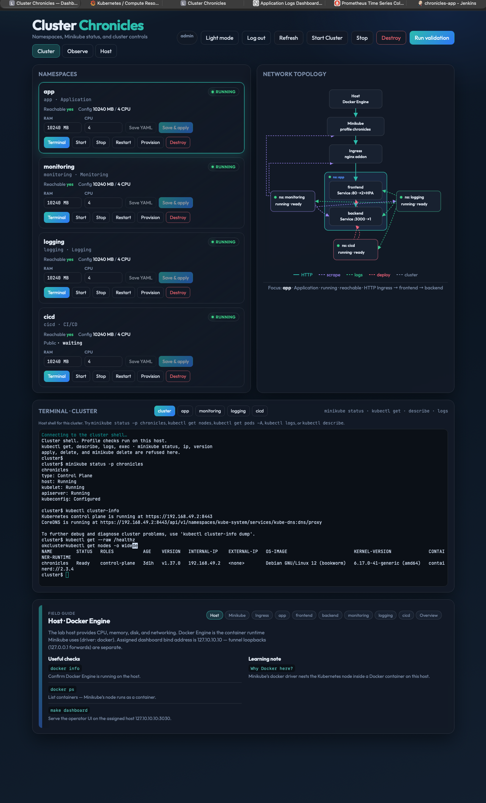</a> | Cluster overview |
| <a href="assets/screenshots/02-dashboard-observe-metrics-ingress.png">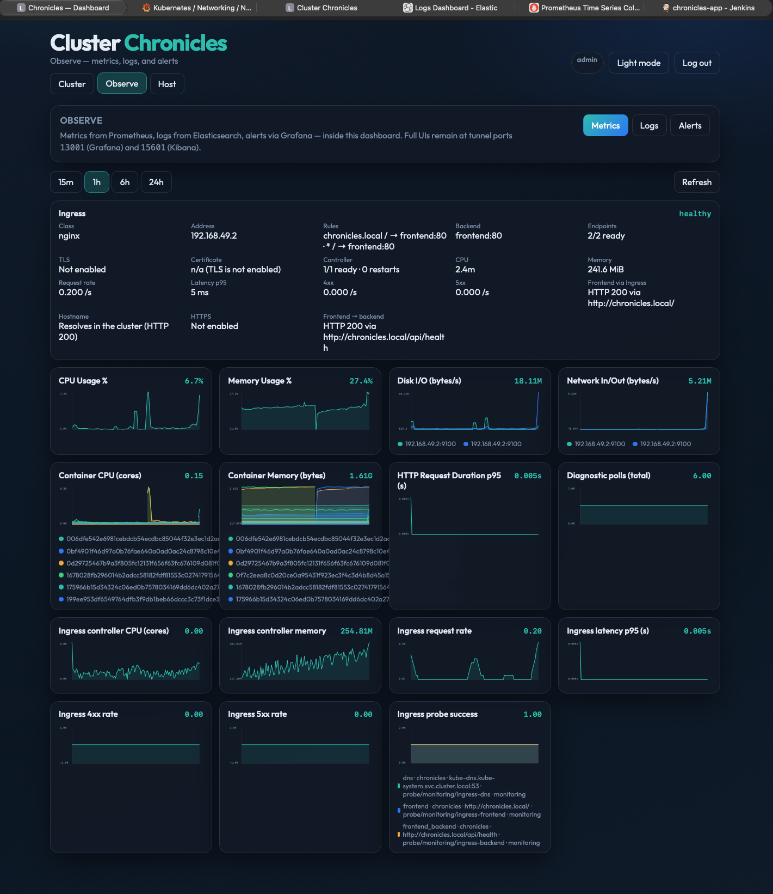</a> | Observe metrics / Ingress |
| <a href="assets/screenshots/03-grafana-dashboards-inventory.png">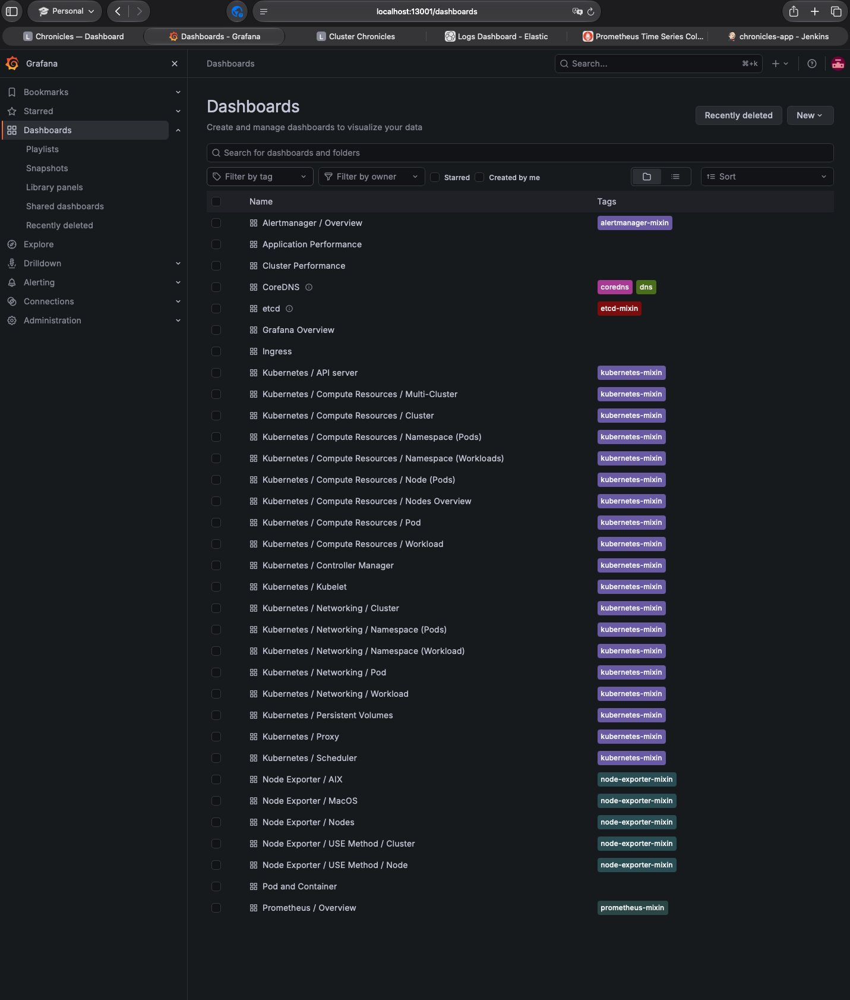</a> | Grafana dashboards list |
| <a href="assets/screenshots/04-grafana-prometheus-overview.png">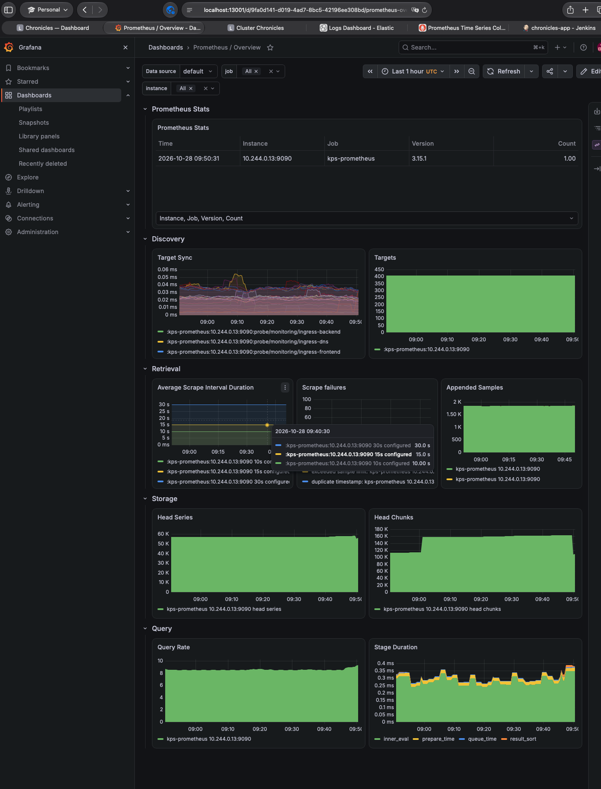</a> | Grafana Prometheus overview |
| <a href="assets/screenshots/05-grafana-k8s-compute-resources.png">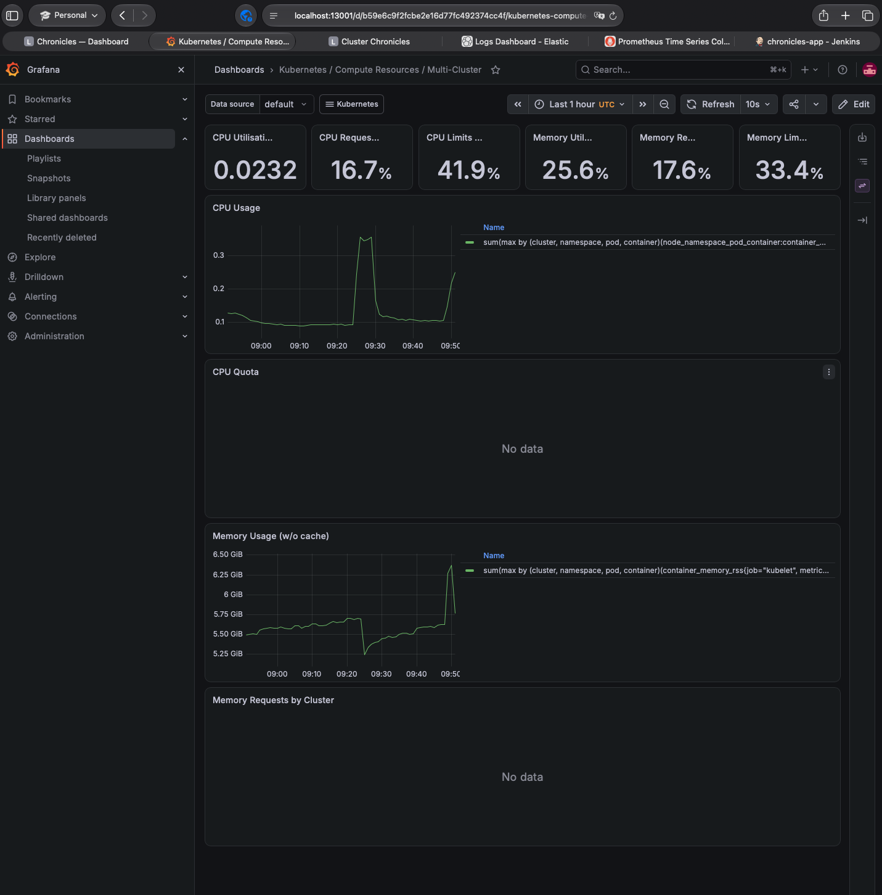</a> | Grafana compute resources |
| <a href="assets/screenshots/06-kibana-dashboards-inventory.png">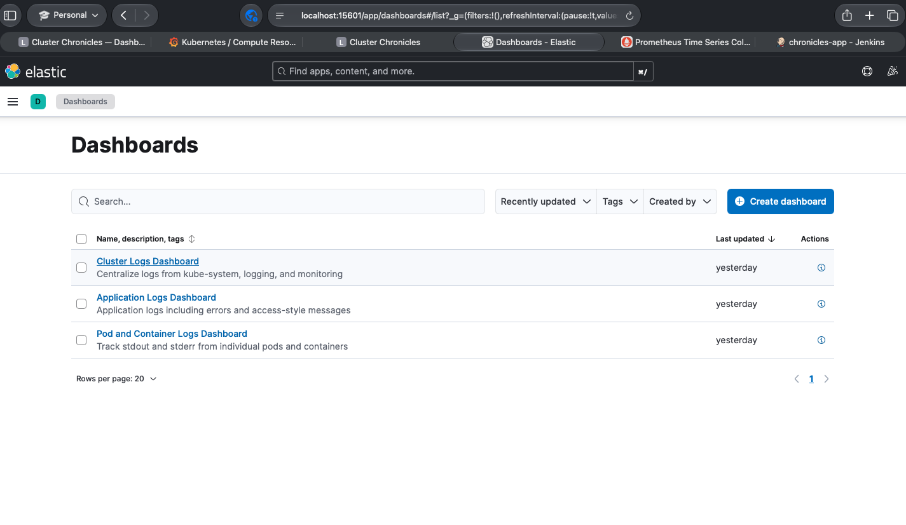</a> | Kibana dashboards list |
| <a href="assets/screenshots/07-kibana-cluster-logs.png">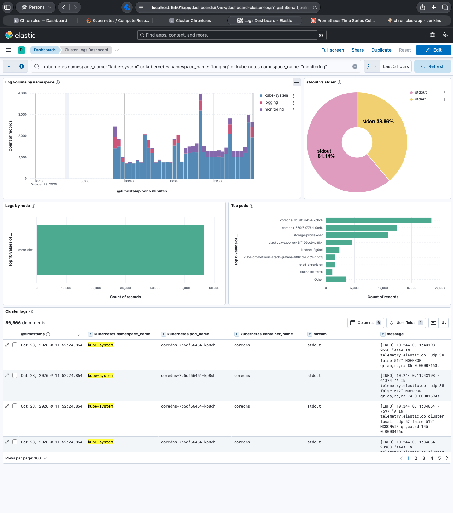</a> | Kibana cluster logs |
| <a href="assets/screenshots/08-kibana-pod-container-logs.png">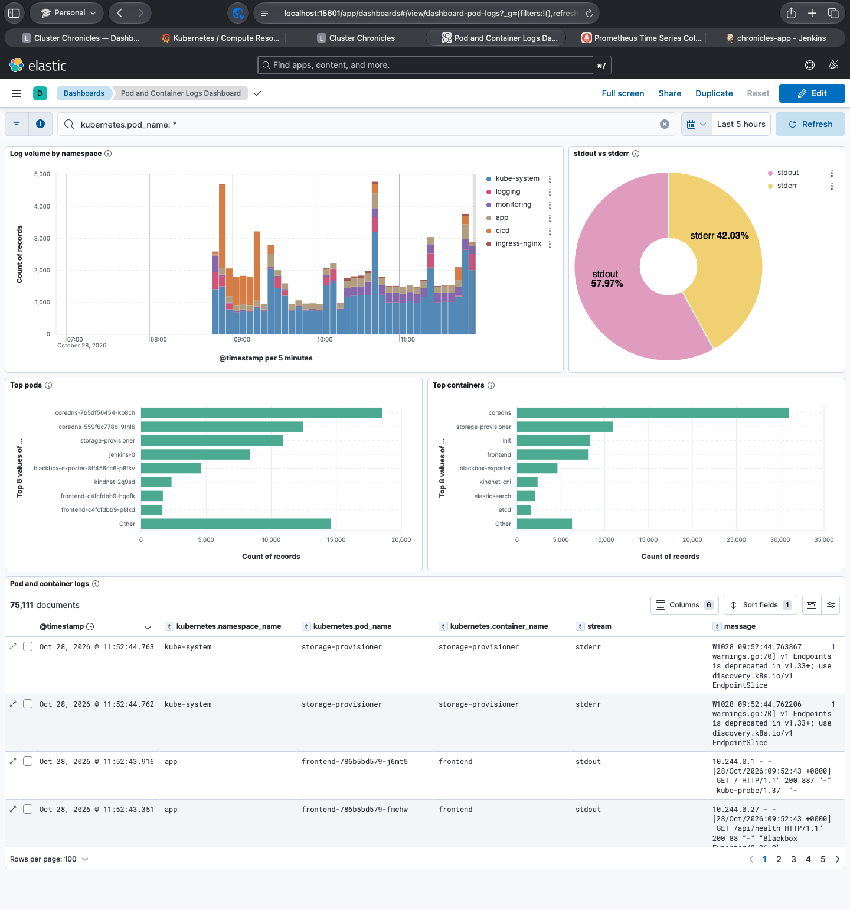</a> | Kibana pod/container logs |
| <a href="assets/screenshots/09-kibana-application-logs.png">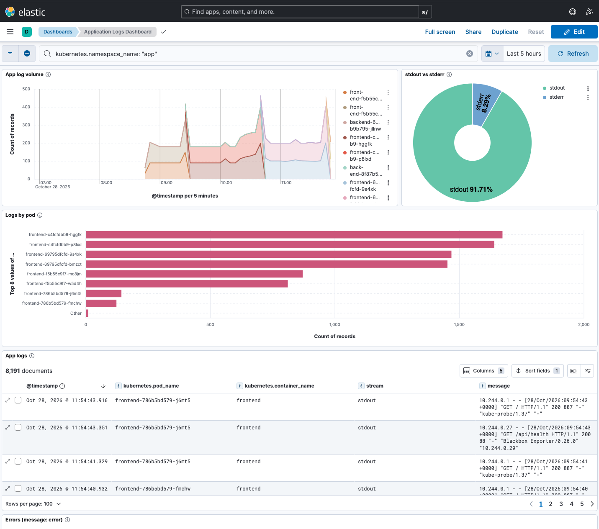</a> | Kibana application logs |
| <a href="assets/screenshots/10-prometheus-alerts-rules.png">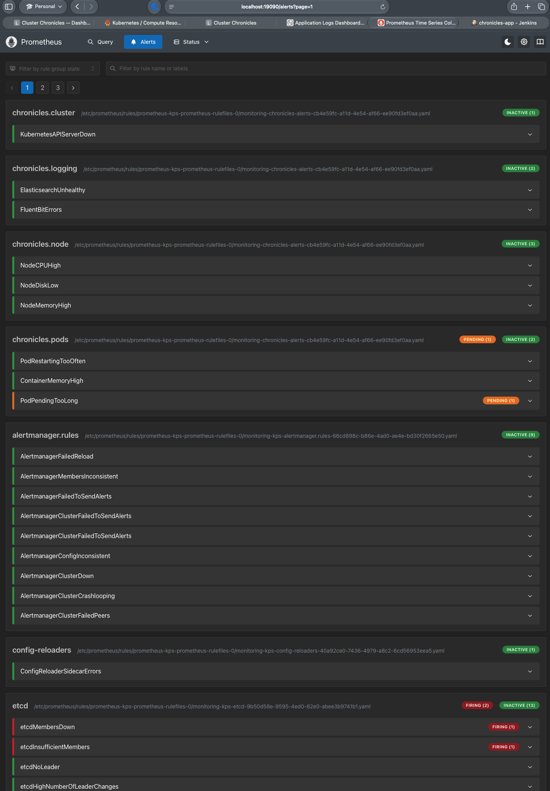</a> | Prometheus alerts |
| <a href="assets/screenshots/11-jenkins-pipeline-stage-view.png">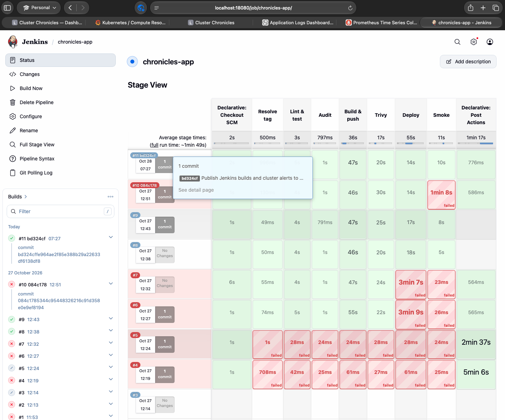</a> | Jenkins stage view |
| <a href="assets/screenshots/12-dashboard-topology-host-detail.png">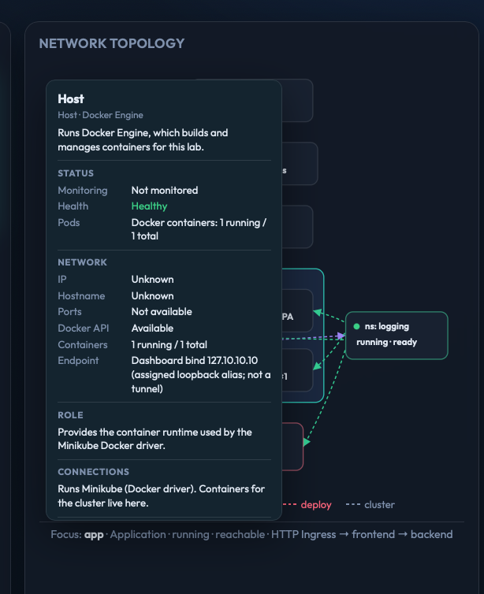</a> | Topology host detail |
