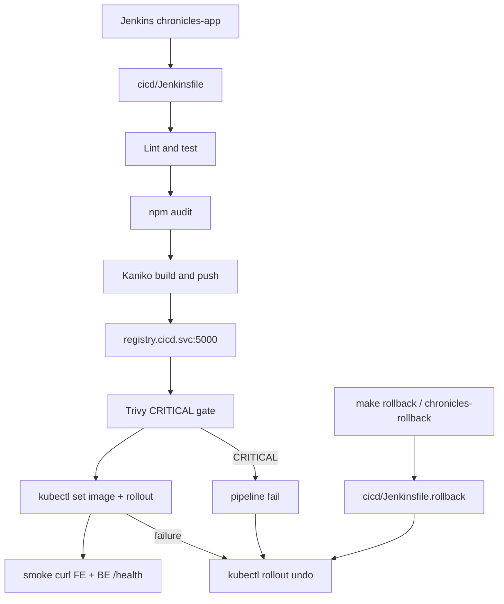
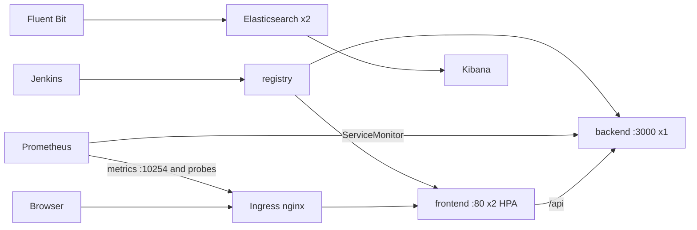

# Architecture

## Components

```text
Host (Linux lab — Local; Docker Engine)
  └── Minikube  (profile: chronicles — config/cluster.yml)
        driver: docker
        └── single-node Kubernetes
              ├── kube-system          control plane + CNI + kube-proxy
              ├── ingress-nginx        Ingress controller (addon)
              │
              ├── app                  namespace
              │     ├── backend        Deployment ×1  :3000  (+ PVC backend-data)
              │     ├── frontend       Deployment ×2  :80   (+ HPA)
              │     ├── Services       ClusterIP (backend, frontend)
              │     └── Ingress        chronicles.local and catch-all → frontend:80
              │
              ├── monitoring           namespace
              │     ├── Prometheus Operator / Prometheus
              │     ├── Grafana        (Cluster, Pod, Application, Ingress)
              │     └── Alertmanager   (node, pod, API, logging, Jenkins, Ingress)
              │
              ├── logging              namespace
              │     ├── Elasticsearch  StatefulSet ×2
              │     ├── Fluent Bit     DaemonSet
              │     └── Kibana
              │
              └── cicd                 namespace
                    ├── Jenkins        (chronicles-app / chronicles-rollback)
                    └── registry       :5000 (in-cluster)
```

Topology diagram: [`assets/topology.svg`](../assets/topology.svg)

Sizing defaults live in [`config/cluster.yml`](../config/cluster.yml). Raise CPU and memory on a larger host when Docker exposes more.

---

## Control plane

| Component | Role |
|-----------|------|
| API server | Front door for kubectl and controllers; validates and persists desired state |
| etcd | Cluster state store |
| Controller manager | Reconciles Deployments, Nodes, endpoints, etc. |
| Scheduler | Places pods on nodes that fit requests |
| kubelet | Runs pods on the node; reports status |

---

## Provisioning flow

```mermaid
flowchart TD
  chronicles[make chronicles] --> script[scripts/chronicles.sh]
  script --> tools[install_tools]
  tools --> mk[start_minikube]
  mk --> cfg[config/cluster.yml]
  mk --> addons[ingress + metrics-server]
  script --> images[build_images]
  images --> beImg[chronicles-backend:latest]
  images --> feImg[chronicles-frontend:latest]
  script --> secrets[apply_secrets]
  secrets --> appSec[Secret app-secrets]
  script --> base[apply_base]
  base --> storage[manifests/storage]
  base --> security[manifests/security]
  base --> app[manifests/app]
  base --> logging[manifests/logging]
  script --> mon[install_monitoring]
  mon --> helmMon[kube-prometheus-stack]
  mon --> rules[prometheus-rules.yaml]
  mon --> boards[grafana-dashboards.yaml]
  mon --> sm[servicemonitor.yaml]
  script --> cicd[install_cicd]
  cicd --> registry[manifests/cicd/registry.yaml]
  cicd --> jenkins[Jenkins Helm + jenkins-values.yaml]
  cicd --> rbac[manifests/security/cicd-rbac.yaml]
  script --> wait[wait_rollouts]
  wait --> urls[print_urls]

  verify[make verify] --> vscript[scripts/verify.sh]
  vscript --> report[PASS or FAIL]
  appv[make app-verify] --> asym[scripts/app-verify.sh]
  review[make review] --> verify
  review --> appv
  stop[make stop / start / restart] --> life["scripts/stop|start|restart.sh"]
  destroy[make destroy] --> del[scripts/destroy.sh]
```



Tear-down: `make stop` (keep disks) · `make destroy` (delete profile only).

---

## Cluster Chronicles CI/CD flow



Agents run as Kubernetes pods with ServiceAccount `jenkins` (Role limited to `app`).

---

## Traffic / roles



- **NetworkPolicy** (default deny in `app`): Ingress → frontend; frontend → backend; monitoring scrape → backend `:3000`.
- **Persistent storage**: Retain PVs for Jenkins / Prometheus / Grafana; backend PVC for app data; ES per-pod PVCs.
- **Custom metric**: `chronicles_diagnostic_polls_total` on backend `/metrics/prom`.

---

## Workloads in this lab

| Kind | What | Why |
|------|------|-----|
| Deployment | backend ×1, frontend ×2 | Stateless, rolling updates, HPA-friendly |
| StatefulSet | Elasticsearch ×2 | Stable network identity + per-pod PVC |
| DaemonSet | Fluent Bit | One log agent per node (one node in Minikube) |
| Namespace | `app`, `monitoring`, `logging`, `cicd` | Isolation and RBAC scope |

App design details:

- Backend: `/health`, `/metrics/prom`
- Frontend nginx proxies `/api` → Service `backend:3000`
- Backend init container writes a marker on the PVC before the app starts
- Rolling update: `maxUnavailable: 0`, `maxSurge: 1`

---

## Minikube limits vs production

- Single node; no multi-AZ etcd or control-plane HA
- hostPath / local PV storage is **ReadWriteOnce**; data does not move with the pod to another node
- Ingress is the nginx addon, not a cloud load balancer
- Resource headroom is smaller — keep requests/limits honest

Files: [`manifests/`](../manifests/), [`cicd/`](../cicd/), [`config/cluster.yml`](../config/cluster.yml), [`scripts/chronicles.sh`](../scripts/chronicles.sh).
